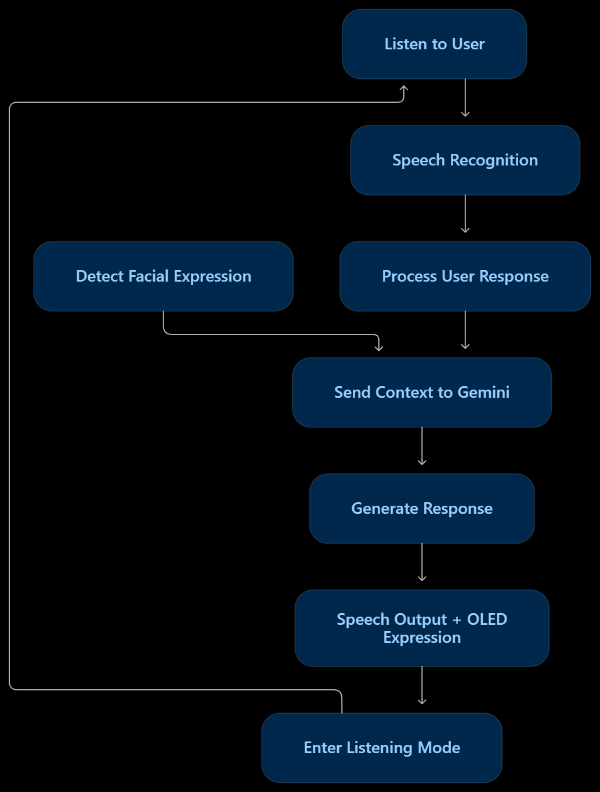

# Mimo — Emotion-Aware Conversational Desktop Companion

A physical AI desktop companion that observes your facial expression without jumping to conclusions, initiates a natural voice conversation, and reacts through synthesized speech and an animated OLED face

## Inspiration

I struggled to open up about my anxiety and insecurities regarding my future. After overcoming it, I realized that some people, especially teenagers, may experience similar feelings but find it difficult to express them or initiate conversations.

I wanted to build a companion that didn't require someone to open up first. Instead of waiting for the user to start a conversation, Mimo observes, gently initiates, and listens without assuming how someone feels.

## Technical Implementation

Mimo bridges computer vision, conversational AI, voice I/O, and microcontroller hardware into a single loop

1. **Emotion Observation (`main.py`):** Captures webcam frames via OpenCV and runs facial emotion detection with DeepFace (`RetinaFace`).
2. **Streak Confirmation:** Requires 5 consecutive matching detections (`CONFIRMATION_THRESHOLD = 5`) before confirming an expression so momentary facial movements don't trigger false reactions.
3. **Contextual AI Response (`mimo_ai.py`):** Sends the confirmed expression to the Gemini API with a system prompt instructing Mimo to respond naturally in one sentence—without assuming how the user feels—and return structured JSON (`{"response", "emotion"}`).
4. **Hardware:** Sends the chosen emotion state (`happy`, `sad`, `angry`, `neutral`) over serial (`COM6` at `9600` baud) to an ESP32 driving an OLED display
5. **Voice Output (`mimo_voice.py`):** speaks the reply using `edge-tts` and `pygame`.
6. **Multi-Turn Voice Chat (`mimo_listen.py`):** Listens via microphone (`SpeechRecognition`) for follow-up replies until the user says `"goodbye mimo"`, `"stop"`, or `"exit"`.

## Pipeline

